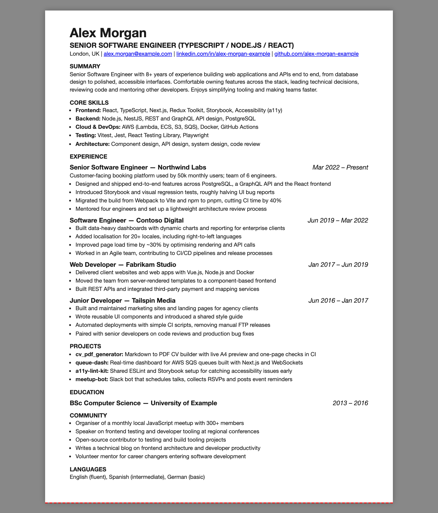
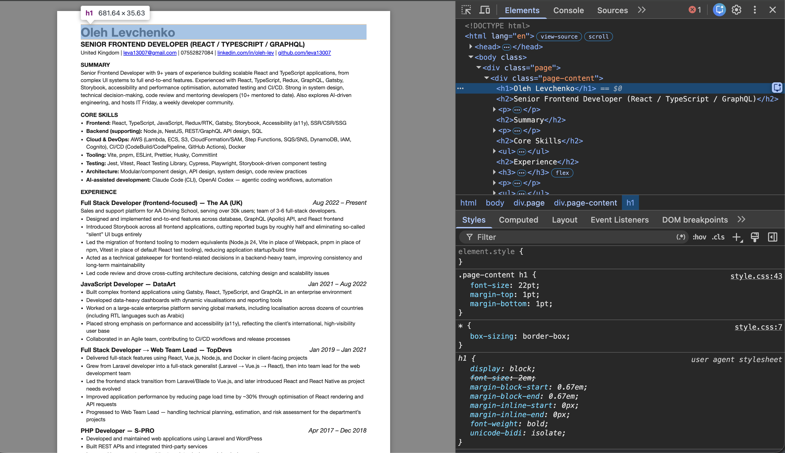

# cv_pdf_generator

Write your CV in Markdown, tune it in a live A4 browser preview, and export a pixel-identical PDF with headless Chrome.



- **Markdown in, PDF out.** Content lives in plain `.md` files, so variants (frontend, backend, full-stack…) are easy to diff and keep in git.
- **Live preview.** Every save of the Markdown, CSS or HTML template reloads the browser instantly.
- **Page-break guide.** A dashed red line marks the real A4 boundary, so you can see exactly what spills onto page 2.
- **What you see is what you get.** The preview and the PDF use the same template and stylesheet; the export only strips the preview-only styling.

## Requirements

- Node.js **22.12+** (needed by Puppeteer)
- npm

Puppeteer downloads a compatible Chrome build during `npm install`.

## Quick start

```bash
git clone <repo-url> cv_pdf_generator
cd cv_pdf_generator
npm install

npm run dev -- examples/cv.example.md   # live preview at http://localhost:3000
node export-pdf.js examples/cv.example.md   # -> examples/cv.example.pdf
```

To start your own CV, copy the example to `cv.md` in the project root. `npm run dev` and `npm run pdf` use `cv.md` by default.

## Usage

### Preview

```bash
npm run dev                   # previews cv.md
npm run dev -- cv_FS.md       # previews any other Markdown file
```

Open <http://localhost:3000>. The page reloads whenever the Markdown file, `style.css` or `template.html` changes.

### Export to PDF

```bash
npm run pdf                    # cv.md -> cv.pdf
node export-pdf.js cv_BE.md    # any file -> <name>.pdf, written next to the source
```

The PDF is A4 with no printer margins; the page margins are set in `style.css`.

### Tests

```bash
npm test            # full suite, including real headless-Chrome PDF exports (~5s)
npm run test:unit   # rendering + preview server only, no browser
```

The suite uses Node's built-in test runner. It checks the Markdown rendering, the preview server's routes and live reload, and the PDF export: A4 size, overflowing onto a second page, and that every `cv*.md` in the repo fits on **one page**. Run `npm test` after editing a CV to catch a page 2 you didn't notice.

## Writing a CV

[`examples/cv.example.md`](./examples/cv.example.md) is a complete one-page CV you can start from. The stylesheet expects this Markdown layout:

```markdown
# Jane Doe
## Senior Software Engineer
London, UK  |  jane@example.com  |  github.com/janedoe

## Summary

A short paragraph about you.

## Experience

### Senior Engineer — Acme Corp _Jan 2022 – Present_

* What you did and the impact it had
* Another achievement
```

- `# Name` must be followed **immediately** by `## Job title`. The stylesheet styles the second element on the page as the subtitle.
- In `### Role — Company _dates_`, the italic dates at the end are pushed to the right edge of the line.
- Raw HTML in the Markdown is escaped, not rendered. Do all styling in `style.css`.
- Bare URLs and emails become links automatically, and quotes and dashes are converted to typographic ones.

Keep one file per CV variant (for example `cv.md`, `cv_FS.md`, `cv_BE.md`) and pass the file name to either command.

## Customising the look

Everything visual lives in [`style.css`](./style.css):

| What | Where |
| --- | --- |
| Page margins | `--page-margin` and the `.page-content` padding |
| Fonts and colours | `body` |
| Heading and text sizes | `.page-content h1` / `h2` / `h3` / `p, li` |
| Styles for the preview only | `.page`, `.page::after`. Hidden in the PDF by `body.printing` |

### Tuning the layout with DevTools

The preview is an ordinary web page, so the quickest way to tidy up spacing is your browser's inspector:

1. Run `npm run dev` and open <http://localhost:3000>.
2. Right-click any part of the CV and choose **Inspect**.
3. The **Styles** panel shows which `style.css` rule styles that element and on which line, for example `.page-content h1` at `style.css:43`.
4. Try new values there (font size, margins, line height) and watch the page change. Keep an eye on the red line if you're trying to fit everything on one page.
5. Copy the values that work into `style.css`. The preview reloads, and the PDF picks up the same styles.



The Elements panel also shows the HTML the Markdown turns into: `h1` for the name, `h2` for the job title and section headings, and `h3` for each role. That makes it easy to see which selector to change.

## How it works

```
cv.md ──► render.js (markdown-it + template.html) ──┬──► server.js     → browser preview + live reload
                                                    └──► export-pdf.js → headless Chrome → cv.pdf
```

| File | Role |
| --- | --- |
| `render.js` | Renders the Markdown and inserts it into `template.html` |
| `template.html` | HTML shell with the A4 page |
| `style.css` | CV styling, shared by the preview and the PDF |
| `server.js` | Preview server on port 3000; watches files and sends reload messages over WebSocket |
| `reload-client.js` | Browser script that reloads the page when told to |
| `export-pdf.js` | Serves the print version on a temporary port and saves it as a PDF with Puppeteer |

Each server serves only the files it lists by name. If you reference a new asset (a font or an image) from the template, add a route for it in both `server.js` and `export-pdf.js`.

## Roadmap

- Generate the PDFs used by the job-application pipeline directly from these Markdown sources.

## Built with

- [markdown-it](https://github.com/markdown-it/markdown-it): Markdown parser
- [Puppeteer](https://pptr.dev/api/puppeteer.page.pdf): headless Chrome PDF export
- [chokidar](https://github.com/paulmillr/chokidar) and [ws](https://github.com/websockets/ws): file watching and live reload
